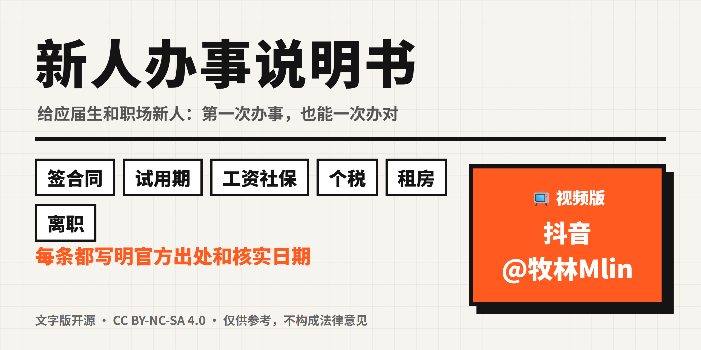

# 新人办事说明书

> 给应届生和职场新人的"办事说明书"：签合同、领工资、交社保、租房子、退税、离职……第一次办，也能一次办对。

每一条规则都写明了**官方出处、条款号和核实日期**。不靠"听说"，只认原文。

### 📥 [下载 PDF 完整版](downloads/新人办事说明书.pdf) · 📺 视频版：**抖音 @牧林Mlin**（搜索「新人办事说明书」）

每个主题都有对应的短视频：一张"照着做"的表，加最容易踩的坑，一分钟讲清楚。

---

## 怎么用
- 每个主题一页，开头先给「照着做」的**清单或对照表**，可以直接截图。
- 每页末尾有**依据**：法律法规的名称、条款号、原文摘录、官方链接和核实日期。
- 规则全国统一的，直接写；**各地不同的**（比如最低工资、社保基数、公积金比例），写明"各地不同"，并告诉你去哪查本地标准。

## 目录
共 8 章 20 个主题。标 📺 的已有抖音视频版，其余陆续更新。

### 一、签约与入职
| 主题 | 核实日期 |
|---|---|
| [offer、三方协议、劳动合同，到底各管什么？](docs/01-签约与入职/offer三方协议劳动合同.md) | 2026-10-27 |
| [签劳动合同之前，先看这 5 处](docs/01-签约与入职/签劳动合同前先看这5处.md) 📺 | 2026-10-26 |
| [入职要交押金、押身份证？不行](docs/01-签约与入职/入职被收押金扣证件.md) | 2026-10-27 |
| [2023 年起没有报到证了，档案怎么走？](docs/01-签约与入职/报到证取消后档案怎么走.md) | 2026-10-27 |

### 二、试用期
| 主题 | 核实日期 |
|---|---|
| [试用期到底能有多长？工资最低给多少？](docs/02-试用期/试用期多长工资多少.md) 📺 | 2026-10-26 |
| [试用期就不交社保？不对](docs/02-试用期/试用期交不交社保.md) | 2026-10-27 |

### 三、工资、加班与休假
| 主题 | 核实日期 |
|---|---|
| [看懂工资条：钱是怎么少的？](docs/03-工资加班与休假/看懂工资条.md) | 2026-10-27 |
| [加班费怎么算？1.5 倍、2 倍、3 倍](docs/03-工资加班与休假/加班费怎么算.md) | 2026-10-27 |
| [年假：工作满一年才有？有几天？](docs/03-工资加班与休假/年假有几天.md) | 2026-10-27 |

### 四、社保与公积金
| 主题 | 核实日期 |
|---|---|
| [五险一金交没交，在哪查？](docs/04-社保与公积金/五险一金交没交在哪查.md) | 2026-10-27 |
| [住房公积金能拿来付房租吗？能](docs/04-社保与公积金/公积金能付房租吗.md) | 2026-10-27 |

### 五、个人所得税
| 主题 | 核实日期 |
|---|---|
| [租房、考证也能少交个税：专项附加扣除别漏填](docs/05-个人所得税/专项附加扣除别漏填.md) | 2026-10-27 |
| [个税年度汇算：谁要办？什么时候办？](docs/05-个人所得税/个税年度汇算.md) | 2026-10-27 |

### 六、租房
| 主题 | 核实日期 |
|---|---|
| [租房合同签之前，看这几处](docs/06-租房/租房合同签之前看这几处.md) | 2026-10-27 |

### 七、离职与维权
| 主题 | 核实日期 |
|---|---|
| [辞职要提前多久？离职证明、档案社保谁来办？](docs/07-离职与维权/辞职提前多久和离职证明.md) | 2026-10-27 |
| [被辞退、合同到期不续，经济补偿"N"怎么算？](docs/07-离职与维权/经济补偿N怎么算.md) | 2026-10-27 |
| [失业了，失业保险金怎么领？](docs/07-离职与维权/失业保险金怎么领.md) | 2026-10-27 |
| [被欠薪、不给补偿：劳动仲裁怎么申请？](docs/07-离职与维权/劳动仲裁怎么申请.md) | 2026-10-27 |

### 八、避坑
| 主题 | 核实日期 |
|---|---|
| [找工作先交钱？押金、培训费、"培训贷"，先停一下](docs/08-避坑/求职被收费和培训贷.md) | 2026-10-27 |
| [第一次报销：发票抬头、税号怎么开才不被退回？](docs/08-避坑/报销发票抬头和税号.md) | 2026-10-27 |

---

## 内容原则
详见 [核实规则.md](核实规则.md)。简单说：
1. **只用官方来源。** 法律以[国家法律法规数据库](https://flk.npc.gov.cn)为准，社保、劳动以人社部门为准，个税以国家税务总局为准。
2. **每条都标核实日期。** 政策有变化时，在[更新记录](CHANGELOG.md)里写明改了什么。
3. **不提供个案法律意见。** 本仓库是普法科普，仅供参考。遇到纠纷，请咨询当地劳动人事争议仲裁委员会，或拨打人社服务热线 12333。

## 发现错误？
欢迎[提 Issue](../../issues/new/choose)，请附上官方出处的链接。核实无误后会尽快更正，并在更新记录里注明。

## 许可
文字内容采用 [CC BY-NC-SA 4.0](https://creativecommons.org/licenses/by-nc-sa/4.0/deed.zh-hans)：可以转载和改编，但要署名、不能用于商业用途，改编后的作品要以相同协议分享。引用的法律法规原文属于公共领域，不受本协议限制。
